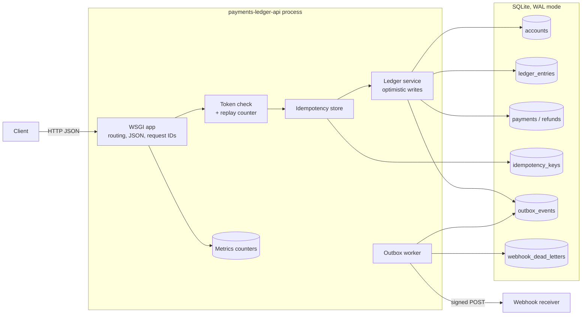
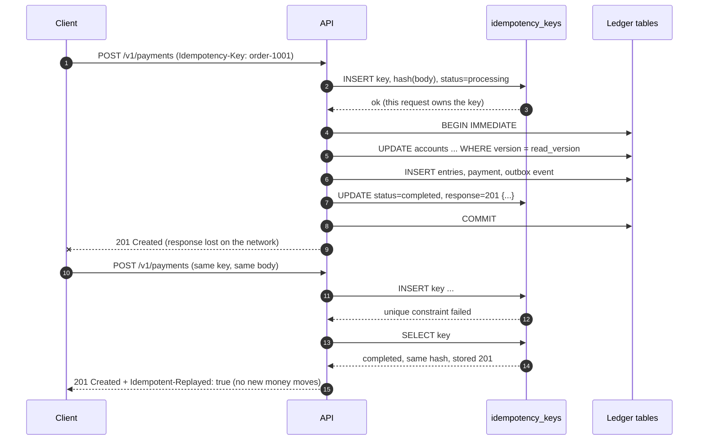

# payments-ledger-api

A small payments API on top of a double-entry ledger. It is built to stay correct when clients retry requests and when many requests hit the same accounts at once.

It uses only the Python standard library (`wsgiref`, `sqlite3`, `hmac`, `hashlib`). The tests use `pytest`.

## The problem

Moving money over HTTP is easy until things go wrong:

- A client sends a payment, the network drops the response, and the client sends it again. Without care, the customer pays twice.
- Two payments read the same balance at the same moment. Both see enough money, both go through, and the account goes negative.
- A payment commits, but the process crashes before the webhook goes out. The merchant never hears about it.
- A stolen auth token is sent again by someone else.
- A client edits a pagination cursor to read data it should not see.

This project handles each of these cases and has a test for each one.

## Features

| Area | What it does |
| --- | --- |
| Double-entry ledger | Every payment, refund, and funding writes balanced debit and credit entries. Balances are kept on the account row and checked against the entries. |
| Idempotency keys | Same key and same body returns the stored response. Same key and different body returns `422`. Concurrent duplicates are stopped by a primary key and a `processing` state. |
| Optimistic concurrency | Each account has a `version`. Writes are conditional on the version that was read. A conflict rolls back and retries with fresh data. Balances cannot go negative. |
| Signed cursors | Pagination cursors are HMAC-SHA256 signed, bound to their query, and expire. Any change is rejected. |
| Token replay detection | A sliding-window counter per token ID. Fail-open or fail-closed is a config flag. |
| Webhook outbox | Events are written in the same transaction as the payment. A worker sends them with exponential backoff and full jitter, then moves them to a dead-letter table after the last attempt. |
| Observability | JSON logs with a request ID on every line, and a `/metrics` endpoint with counters. |

## Architecture



One write transaction holds the balance updates, the ledger entries, the payment row, the outbox event, and the stored idempotent response. Either all of them commit or none do.

## An idempotent retry



If the second request comes while the first is still running, the row is still `processing`, and the API returns `409 idempotency_in_progress` with `Retry-After: 1`.

## Run it

Requires Python 3.11 or later.

```bash
python -m venv .venv && source .venv/bin/activate
pip install -e '.[dev]'
pytest -q

export LEDGER_AUTH_SECRET=change-me LEDGER_CURSOR_SECRET=change-me-too LEDGER_WEBHOOK_SECRET=change-me-three
python -m ledger          # listens on 127.0.0.1:8080
```

The server binds to `127.0.0.1` by default. Set `LEDGER_WEBHOOK_URL` to send webhooks to a real receiver. Without it, the worker writes each delivery to the log.

| Variable | Default | Meaning |
| --- | --- | --- |
| `LEDGER_DB_PATH` | `ledger.db` | SQLite file |
| `LEDGER_HOST` / `LEDGER_PORT` | `127.0.0.1` / `8080` | Listen address |
| `LEDGER_AUTH_SECRET` | random | HMAC key for bearer tokens |
| `LEDGER_CURSOR_SECRET` | random | HMAC key for cursors |
| `LEDGER_REPLAY_FAIL_MODE` | `closed` | `open` or `closed` when the replay store fails |
| `LEDGER_REPLAY_WINDOW_SECONDS` | `300` | Replay window, and the longest token lifetime allowed |
| `LEDGER_TOKEN_MAX_USES` | `1` | Uses allowed per token in the window |
| `LEDGER_WEBHOOK_URL` | unset | Where the outbox worker sends events |

## API examples

Tokens are single use by default, so the examples mint a new one per request. A retry uses a **new auth token** and the **same idempotency key**: the token proves who is calling now, and the key says "this is the same operation as before".

```bash
API=http://127.0.0.1:8080
tok() { python -m ledger.token --sub demo-client; }
```

Create two accounts. `initial_balance` is funded from a system account so the books stay balanced.

```bash
curl -s -X POST $API/v1/accounts -H "Authorization: Bearer $(tok)" \
  -H 'Content-Type: application/json' -d '{"name":"alice","currency":"USD","initial_balance":10000}'
```
```json
{"id": "acct_55a45c780e4a4055addfdff8", "object": "account", "name": "alice", "currency": "USD", "balance": 10000, "version": 1, "created_at": 1793926387.8594172}
```

Create a payment. Amounts are integers in minor units (cents).

```bash
curl -s -i -X POST $API/v1/payments -H "Authorization: Bearer $(tok)" \
  -H 'Content-Type: application/json' -H 'Idempotency-Key: order-1001' \
  -d '{"source_account_id":"acct_55a4...","destination_account_id":"acct_2c8f...","amount":2500,"currency":"USD"}'
```
```
HTTP/1.0 201 Created
X-Request-Id: req_f691ae38981447c488c1
{"id": "pay_7a0691dc3a4748edb9fa5e09", "object": "payment", "amount": 2500, "currency": "USD", "status": "succeeded", "refunded_amount": 0, ...}
```

Send the same request again. The response is the same, and no money moves.

```
HTTP/1.0 201 Created
Idempotent-Replayed: true
{"id": "pay_7a0691dc3a4748edb9fa5e09", ...}
```

Reuse the key with a different amount:

```
HTTP/1.0 422 Unprocessable Entity
{"error": {"code": "idempotency_key_reused", "message": "this idempotency key was used with a different request"}, "request_id": "req_f679a6856f53485e8817"}
```

Get a payment, refund part of it, and list entries:

```bash
curl -s $API/v1/payments/pay_7a0691dc3a4748edb9fa5e09 -H "Authorization: Bearer $(tok)"

curl -s -X POST $API/v1/payments/pay_7a0691dc3a4748edb9fa5e09/refunds -H "Authorization: Bearer $(tok)" \
  -H 'Content-Type: application/json' -H 'Idempotency-Key: refund-1' -d '{"amount":1000}'
# {"id": "re_9f77...", "object": "refund", "amount": 1000, "payment_status": "partially_refunded", ...}

curl -s "$API/v1/ledger_entries?account_id=acct_55a4...&limit=2" -H "Authorization: Bearer $(tok)"
# {"object": "list", "data": [...2 entries...], "has_more": true, "next_cursor": "eyJhZnRlciI6My...mCHK3WAs..."}

curl -s "$API/v1/ledger_entries?account_id=acct_55a4...&limit=2&cursor=<next_cursor>" -H "Authorization: Bearer $(tok)"
```

Change one character of the cursor and the request fails:

```json
{"error": {"code": "invalid_cursor", "message": "cursor is invalid or was modified"}, "request_id": "req_8cbf2af1bff74aceba9d"}
```

Send one token twice:

```json
{"error": {"code": "token_replayed", "message": "token was already used"}, "request_id": "req_002f3ec7bab44edc820d"}
```

Check the ledger and read the counters:

```bash
curl -s $API/v1/invariants -H "Authorization: Bearer $(tok)"
# {"ok": true, "violations": [], "net_by_currency": {"USD": 0}}

curl -s $API/metrics
# {"uptime_seconds": 18.3, "counters": {"idempotent_replays_total": 1, "outbox_delivered_total": 2, "token_replay_rejected_total": 1, ...}}
```

### Endpoints

| Method | Path | Notes |
| --- | --- | --- |
| `POST` | `/v1/accounts` | `Idempotency-Key` optional |
| `GET` | `/v1/accounts/{id}` | |
| `POST` | `/v1/payments` | `Idempotency-Key` required |
| `GET` | `/v1/payments/{id}` | |
| `POST` | `/v1/payments/{id}/refunds` | `Idempotency-Key` required. Omit `amount` to refund what remains. |
| `GET` | `/v1/ledger_entries` | `account_id`, `limit` (1-100), `cursor` |
| `GET` | `/v1/invariants` | Runs the ledger checks |
| `GET` | `/health`, `/metrics` | No auth. Meant for a private network. |

Errors always look like `{"error": {"code", "message"}, "request_id"}`.

## Design trade-offs

### Why double-entry

A single `balance` column can drift, and you cannot tell why. With double-entry, every movement is a set of entries that sums to zero, so money is never created or lost by accident. The account balance is a cache of its entries. `/v1/invariants` checks four rules: every transaction nets to zero, every balance equals the sum of its entries, no customer account is negative, and every payment's `refunded_amount` equals the sum of its refunds.

Money that enters from outside (an initial balance) comes from a per-currency system account that is allowed to go negative. That account stands for the outside world, so the whole ledger still sums to zero.

Debit means money leaves an account and credit means money arrives. This matches how a platform books customer wallets, which are liabilities.

### Idempotency semantics

- The key is scoped to the caller, so two clients can use the same key value without a clash.
- The request hash covers the method, path, and the canonical JSON body. A different body with the same key is a client bug, so the API returns `422` and does not guess.
- The stored response is written in the same transaction as the payment. A crash cannot leave a payment without its stored response, or a stored response without its payment.
- Business errors such as `insufficient_funds` are stored and replayed too. The answer to "this exact request" does not change later. A client that wants to try again after a top-up uses a new key.
- Errors that can change on retry (`409`, `503`, `5xx`) release the key, so the client can retry with the same key.
- If a request dies while it holds a key, the lock expires after 30 seconds and the next request takes it over. Each owner has a random token. The final write checks it, so an old owner that wakes up late cannot commit.

### Optimistic vs pessimistic locking

Pessimistic locking (`SELECT ... FOR UPDATE`) holds row locks while the code checks rules. It is simple, but slow callers block others, and lock order mistakes cause deadlocks.

Here, the code reads the accounts and checks the rules with no lock held. Then it updates each row with `WHERE version = <the version it read>`. If any update hits zero rows, another request got there first, so the transaction rolls back and the operation runs again with fresh data, with a short random backoff. After 8 tries it returns `409 concurrent_update`. A `CHECK (balance >= 0)` constraint on the table is a last line of defense.

This works well when most requests touch different accounts. One very busy account (for example a platform fee account) would see many retries. Pessimistic locks or sharded sub-accounts are a better fit there.

SQLite allows one writer at a time, and `BEGIN IMMEDIATE` takes that lock up front. The version check still matters, because the read happens before the lock. On Postgres the same pattern lets writes to different rows run in parallel.

### Fail-open vs fail-closed replay checks

The replay counter lives in a store that can fail, like a Redis cluster in production. When it fails, the service must pick one:

- **Fail-closed** (default): reject with `503`. No replayed token gets through, but an outage in the counter store becomes an outage of the API.
- **Fail-open**: let the request through and log a warning with a metric. The API stays up, but a stolen token can be replayed during the outage.

For money movement, fail-closed is the safer default. Fail-open can make sense for read-only endpoints, or when other layers (short token lifetimes, mTLS) already limit the damage. The tests cover both modes.

The counter uses two fixed buckets and weights the previous bucket by how much of it still falls inside the window. Token lifetime cannot be longer than the window, so with a limit of one use the check is exact for the whole life of the token.

### Signed cursors, not encrypted

The goal was an encrypted cursor. The Python standard library has no AES, and a hand-made cipher is a worse risk than a readable cursor. So cursors are HMAC-SHA256 signed and base64url encoded:

- Clients **cannot forge or change** a cursor. Any edit fails the signature check.
- Clients **can decode** it and see the internal position and the filter. Nothing secret goes in the payload, and public IDs are random, so the position number does not expose other records.
- Each cursor is bound to its query (`account_id`) and expires after 24 hours.
- Keys are derived per purpose (`cursor:v1`, `auth:v1`), so a cursor can never pass as an auth token.

With a third-party library, use AES-GCM (for example `cryptography`'s `AESGCM` or Fernet) to also hide the contents.

### Outbox, not "send after commit"

Sending the webhook after the commit loses events when the process crashes between the two steps. Sending it inside the transaction holds locks while waiting on a remote server. The outbox writes the event in the same transaction as the payment, and a separate worker delivers it. Delivery is at least once, so receivers must dedupe on the `Webhook-Id` header. Retries use full jitter (`random(0, min(cap, base * 2^n))`) so a receiver that comes back is not hit by every retry at once. After the last attempt the event moves to `webhook_dead_letters` for a human or a replay job. Each worker leases an event before it sends it, so several workers can run together.

## Tests

```
$ pytest -q
................................................                         [100%]
48 passed
```

| File | What it proves |
| --- | --- |
| `test_payments.py` | Balanced entries, validation, insufficient funds has no side effects, request IDs, metrics |
| `test_idempotency.py` | Retries replay, key reuse with another body is `422`, `processing` gives `409`, stale lock takeover, 12 concurrent duplicates make one payment, crash releases the key |
| `test_concurrency.py` | 8 threads x 25 random transfers keep the total and invariants; 20 threads overdraw an account and exactly 10 win; a forced version conflict retries with fresh data |
| `test_refunds.py` | Full and partial refunds, over-refund, refund without funds, idempotent refund, 8 concurrent full refunds and one wins |
| `test_cursor.py` | Full pagination, edited cursor, cursor from another query, another key, expiry |
| `test_replay.py` | Replay rejected, forged and expired tokens, fail-open and fail-closed, sliding window math |
| `test_outbox.py` | Event in the same transaction, retry with backoff, dead letter after max attempts, leases |

## Limitations

- **The auth token is a demo.** It is an HMAC token signed with a shared secret, made to show replay detection. A real system should take tokens from an identity provider (OAuth 2.0 / OIDC JWTs, or mTLS between services) and add per-account authorization. Today any valid caller can act on any account.
- **SQLite allows one writer at a time.** That is fine for a demo and for tests, but it limits write throughput.
- **The replay counter is in memory.** It resets on restart and is not shared between processes. Production needs a shared store such as Redis.
- **Single currency per account.** There is no FX.
- **Payments settle at once.** There is no pending, authorized, or failed state, and no link to a real payment rail.
- **Idempotency keys never expire.** A real system deletes them after about 24 hours.
- **Cursors are readable** (see above).
- **`/metrics` has no auth.** It is meant for a private network scrape and the server binds to loopback by default.

## Next steps

- Move to Postgres and compare optimistic and `SELECT ... FOR UPDATE` under contention.
- Add holds (authorize, then capture or void) as a two-phase flow on top of the ledger.
- Put the replay counter and idempotency store behind Redis, with a chaos test for the fail modes.
- Add an expiry job for idempotency keys and a replay tool for dead letters.
- Add OpenTelemetry traces and a Prometheus text format for `/metrics`.
- Add property-based tests (Hypothesis) that run random operations and check the invariants after each one.

## License

MIT. See [LICENSE](LICENSE).
